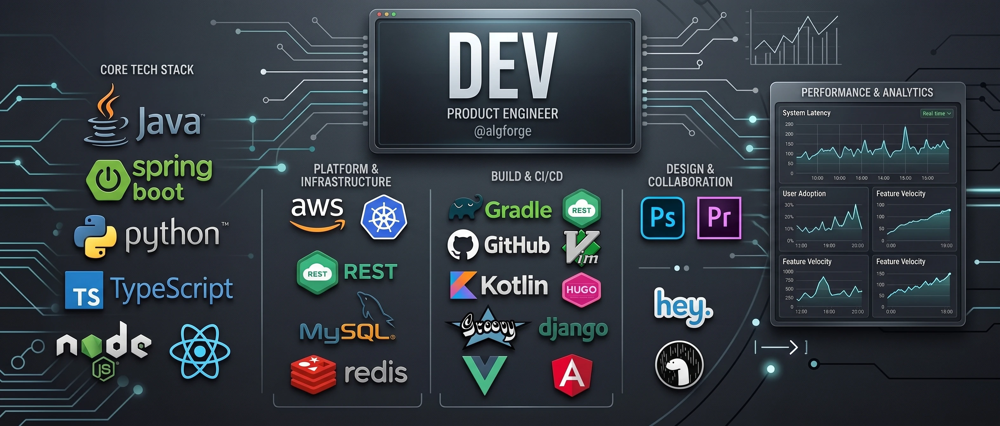

# [Arturo L. Gómez](https://lgzarturo.com)
### Technical Leader | Software Architect | Product Engineer

> Creador de CodeConductor (AI Engineering, Open Source)

Construyo **productos digitales** que resuelven **problemas reales de negocio**.

`Spring Boot` `Kotlin` `Django` `Laravel` `React` `Software Architecture` `Microservices` `Product Engineering` `Cloud` `SaaS`

---

## 👨🏻‍💻 Sobre mí

Diseño **arquitecturas escalables** que sobreviven al crecimiento del negocio. Como **Technical Leader**, **Software Architect** y **Product Engineer**, dirijo la evolución de **sistemas core** en **Hospitality**, **Travel Tech** y **SaaS**: **motores de reservación**, **plataformas de lealtad** y **ATS (Applicant Tracking Systems)** con miles de usuarios activos.

**Track record** medible: migración de **70,000+ usuarios** a **arquitectura de microservicios** sin **downtime** (+25% suscriptores), reducción del **40% en tiempos operativos** mediante **automatización**, incremento del **60% en clientes corporativos** tras un rediseño completo de plataforma.

15 años en la industria hotelera y de tecnología me enseñaron algo que ningún framework enseña: **el código más importante es el que no tienes que reescribir dos años después.** Conozco el dominio — reservaciones, canal directo, programas de lealtad, gestión de RRHH, plataformas SaaS — y eso me permite tomar decisiones técnicas que sobreviven al negocio. Especializado en arquitecturas de microservicios, sistemas distribuidos y diseño de APIs escalables.

Además, soy creador de **CodeConductor**, un **framework Open Source** para **AI-Assisted Software Engineering**, enfocado en **Multi-Agent Orchestration**, **LLM Workflows**, **Prompt Engineering**, **Task Orchestration**, **TDD**, **Code Review** y **Developer Experience (DX)**. Mi objetivo es transformar el prompting improvisado en procesos reproducibles para equipos de ingeniería.

Me interesa colaborar en proyectos de **Hospitality**, **Travel Tech**, **SaaS**, **Artificial Intelligence**, **Developer Tools**, **Platform Engineering** y **Software Architecture**, donde la tecnología genere ventajas competitivas medibles.

> **CodeConductor** es un framework **Open Source** para **AI-Assisted Software Engineering** que convierte instrucciones de alto nivel en **workflows reproducibles**, permitiendo planificar, implementar, revisar y documentar software mediante **orquestación de agentes de IA**.
> 
> 💡 _"El código limpio no es una meta, es una consecuencia de entender profundamente el problema que estás resolviendo."_

---

## 💼 Productos en producción

No solo escribo sobre software — construyo productos que generan valor real:

- 🔹 **[Revenatium.com](https://revenatium.com)** — Arquitecto líder. Microservicios y plataformas escalables para el sector hotelero: motor de reservaciones, canal directo, loyalty. [[📖 Ver Arquitectura](docs/projects/revenatium/README.md)]
- 🔹 **[StarTalent.mx](https://startalent.mx)** — SaaS completo para gestión de RRHH. Optimización y evolución continua. *Stack: Java, Spring, React.* [[📖 Ver Arquitectura](docs/projects/startalent/README.md)]
- 🔹 **[arthurolg.com](https://arthurolg.com)** — Hub digital sobre tecnología, tutoriales y branding. +50 artículos publicados.
- 🔹 **[MiraElJuego.com](https://miraeljuego.com)** — Experiencia interactiva (Card Game). *Stack: React.*

---

## 📐 Arquitectura & Casos de Estudio

Para profundizar en el diseño técnico, decisiones de arquitectura (**ADRs**) y diagramas de los sistemas que lidero y construyo, consulta la documentación detallada:

| Proyecto | Descripción Arquitectónica | Documentación |
| :--- | :--- | :---: |
| 🏨 **Revenatium** | Motor de reservaciones, lealtad y microservicios hospitality | [📖 Ver Caso de Estudio](docs/projects/revenatium/README.md) |
| 🤖 **CodeConductor** | Framework Open Source para orquestación de agentes de IA | [📖 Ver Caso de Estudio](docs/projects/codeconductor/README.md) |
| 💼 **StarTalent** | SaaS ATS para gestión de talento y embudos de reclutamiento | [📖 Ver Caso de Estudio](docs/projects/startalent/README.md) |

> 📁 *Puedes explorar el índice general de arquitectura en la carpeta [`docs/`](docs/README.md).*

---

## 🏆 Proyectos que demuestran criterio

Arquitectura, buenas prácticas y sistemas diseñados para producción:

### ☕ API REST: Spring Boot + Kotlin

**[Ver Repositorio](https://github.com/lgzarturo/blog)**

- **Arquitectura hexagonal (ports & adapters)** — separación clara entre dominio, aplicación e infraestructura. El dominio no conoce Spring ni JPA.
- **Clean Architecture en capas** — controllers → services → repositories → entities. Cada capa tiene una responsabilidad y testing independiente.
- **Gradle multi-módulo** — separación de concerns en módulos independientes (domain, application, infrastructure, api). Build escalable y mantenible.
- **Patrones de diseño aplicados** — DTO pattern, Repository pattern, Service layer, Dependency Injection via Spring Boot. Testing con MockK.

`Kotlin` `Spring Boot` `REST API` `Gradle` `Hexagonal Architecture` `Clean Architecture`

---

### 🤖 CodeConductor: AI-assisted Engineering

**[Ver Repositorio](https://github.com/lgzarturo/codeconductor)** • **[📖 Ver Caso de Estudio](docs/projects/codeconductor/README.md)**

- **Framework de ingeniería asistida por AI** — convierte el desarrollo en un sistema reproducible con prompts estructurados, validaciones y workflows.
- **Arquitectura de skills modular** — sistema de habilidades especializadas (backlog, openspec, testing, security) que se cargan bajo demanda según contexto.
- **CCEP (CodeConductor Execution Protocol)** — protocolo de ejecución con fases: parse → resolve → evaluate → plan → implement → validate. Gate-based workflow.
- **Developer Experience first** — CLI commands, validaciones automáticas, task cards con acceptance criteria medibles. Zero ambiguity en handoffs.

`TypeScript` `AI Solutions` `Developer Experience` `System Design` `CLI` `Workflow Automation`

---

## 🧭 Situación actual

- 🏗️ **Arquitecto en [Revenatium.com](https://revenatium.com)** — liderando microservicios y plataformas para el sector hotelero.
- 💼 **Mantenimiento en [StarTalent.mx](https://startalent.mx)** — optimización continua de SaaS de RRHH.
- 🚀 **Exploración técnica** — arquitecturas distribuidas y aplicaciones con capacidades de AI para próximos productos.

---

## 🧰 Stack principal

`Spring Boot` • `Django` • `Laravel` • `React` • `PostgreSQL` • `AWS` • `Docker`

Perfil híbrido **Ingeniería + Diseño**: entiendo cómo funcionan los bits en el servidor y cómo se siente la interfaz para el usuario. Diseño (Adobe CC, UI/UX) y estrategia (SEO técnico, marketing de conversión) al servicio del producto.

---

## 📰 Últimas publicaciones

Escribo regularmente en **[arthurolg.com](https://www.arthurolg.com/)** para ayudar a otros desarrolladores a escalar sus carreras:

<!-- BLOG-ALG:START -->
- [No Hackearon el Congelador: Hackearon el Panel que lo Controla desde Internet](https://www.arthurolg.com/article/technology_no-hackearon-el-congelador-paneles-ot-internet/)
- [Panorama IA 2026: La Cadena de Valor, las Cifras del T3 y Qué es Real Frente al Ruido](https://www.arthurolg.com/article/technology_panorama-ia-2026-cadena-valor-cifras-hechos-cuellos-botella/)
- [Tu agente de código guarda tus secretos en texto plano: 1,379 ya están en GitHub](https://www.arthurolg.com/article/technology_agente-codigo-secretos-texto-plano-settings-local-json/)
- [Antes de elegir modelo, define qué significa terminar](https://www.arthurolg.com/article/technology_antes-de-elegir-modelo-define-que-significa-terminar/)
- [El Tablero Real de la IA: Cómputo, Integración Vertical y la Batalla que el Marketing no Puede Ganar](https://www.arthurolg.com/article/technology_tablero-real-ia-computo-integracion-vertical-distribucion/)
- [Más Allá de Teclear Código: Por Qué la IA Debe Mejorar Nuestro Trabajo y no Solo Multiplicarlo](https://www.arthurolg.com/article/technology_mas-alla-teclear-codigo-ia-ingenieria-productividad-condiciones/)
- [¿A Quién le Creo al Elegir un Modelo para Programar? Workers, Razonadores y el Secreto del Effort](https://www.arthurolg.com/article/technology_elegir-modelo-ia-programar-workers-razonadores-effort/)
<!-- BLOG-ALG:END -->

---

### ¿Construyes un producto SaaS o plataforma hotelera? Hablemos.

[📧 Escríbeme](mailto:lgzarturo@gmail.com) • [🐦 Twitter / X](https://x.com/algforge) • [💼 LinkedIn](https://www.linkedin.com/in/lgzarturo/)

